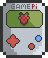
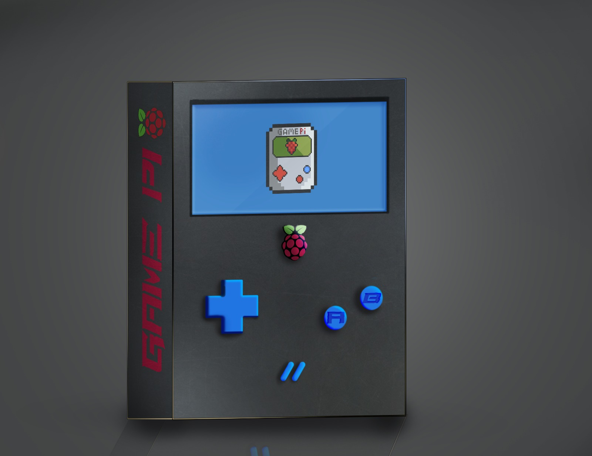

<p align="center">


  
  <h1 align="center">🎮 <b>GamePI</b></h1>
  <p align="center">
  <b>Game Boy Emulator for Raspberry Pi 4</b> <br>
  <i>🕹️🍓Fast, lightweight, and open-source!</i>
</p>

---

## 🚀 **Getting Started**

### 1️⃣ **Clone the Repository**
```bash
git clone https://github.com/nadav26740/GamePI.git
```

### 2️⃣ **Automatic Installation** 🤖
```bash
cd GamePI
./install.sh
```

### 3️⃣ **Manual Installation** 🛠️

#### 📦 **Install Requirements**
- See [Requirements](#requirements) below.

#### ⚒️ **Build the Emulator**
```bash
cd GamePI/src
./build.sh --release
```

#### 📁 **Setup Game Folders**
```bash
cd
mkdir .GAMEPI
cd .GAMEPI
mkdir EMULATOR_GAMES   # Place your ROMs here 🎲
```

---

## 📋 **Requirements**

- **SFML 2.5.2** — Graphics, audio, and input
- **C++17** — Modern C++ features

---

## 📚 **Documentation**

Explore the core architecture and modules:

| Component                | Description                                                                 | Link                                               |
|--------------------------|-----------------------------------------------------------------------------|----------------------------------------------------|
| 🗂️ AssetsCacheManager    | Efficient caching and retrieval of game assets                              | [Docs/Core/AssetsCacheManager.md](Docs/Core/AssetsCacheManager.md) |
| ⚙️ ConfigLoader          | Flexible loading and parsing of configuration files                         | [Docs/Core/Class_ConfigLoader.md](Docs/Core/Class_ConfigLoader.md) |
| 🎬 Scene                 | Scene management, transitions, and rendering logic                          | [Docs/Core/Class_Scene.md](Docs/Core/Class_Scene.md) |
| 🖼️ Scene_Interface       | Contract for scene management and engine integration                        | [Docs/Core/Scene_Interface.md](Docs/Core/Scene_Interface.md) |
| 🚀 sfmlboost             | Extended SFML utilities and performance helpers                             | [Docs/Core/sfmlboost.md](Docs/Core/sfmlboost.md) |
| 🎨 Themes                | Customizable visual styles for UI and components                            | [Docs/Core/themes.md](Docs/Core/themes.md) |
| 🗂️ Architecture Diagrams | Visual workflow of asset management                                         | [Docs/Core/Assets_Cache_Manager_v1.drawio.svg](Docs/Core/Assets_Cache_Manager_v1.drawio.svg) |

> For more details, see the [Docs/README.md](Docs/readme.md).

---

## 📝 **License**

This project is licensed under the [Apache License](./License) 📄

---

## 🖼️ **Concept Image**



---

## 💡 **Features**

- **Fast emulation** for Game Boy games
- **Optimized for Raspberry Pi 4**
- **Modular architecture** for easy extension
- **Asset caching** for smooth gameplay
- **Scene management** for flexible game logic
- **Custom themes** for UI personalization

---

## 💬 **Contributing**

Pull requests and issues are welcome!  
See [CONTRIBUTING.md](./CONTRIBUTING.md) for guidelines.

---

Have fun playing Game Boy games on your Raspberry Pi!
